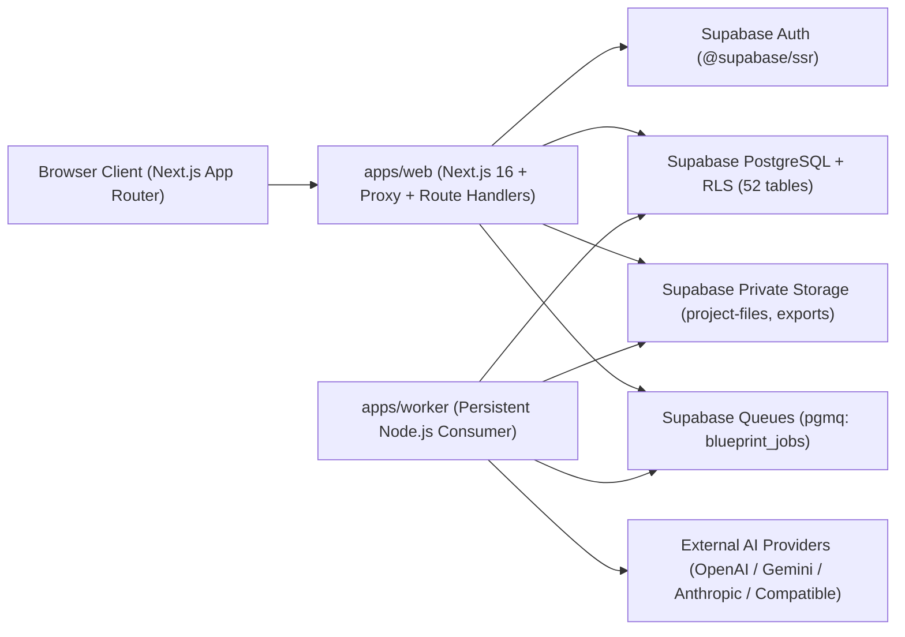

# Architecture Decision Records (D-001 through D-014) & Risk Mitigations

## System Architecture Summary

## Decision Register

- **D-001..D-006 (Confirmed)**: Next.js 16 + TypeScript, Supabase PostgreSQL/Auth/Storage, Supabase Queues (`pgmq`) with persistent worker in same monorepo, multi-provider AI adapters, task-level model override without mutating defaults, server-only credentials.
- **D-007 (Workspace Tenancy)**: Workspace is the strict tenant boundary (`workspace_id` on every tenant-owned table). Projects inherit workspace scope and support optional `restricted_access = true` enforced via `project_members` + RLS helper `bp_can_access_project()`.
- **D-008 (Immutable Artifact Structure)**: Canonical JSON (`artifact_revisions.content`) paired with relational `artifact_sections` and enforced by PostgreSQL trigger `trg_artifact_revisions_immutable`.
- **D-009 (AI Credential Storage)**: AES-256-GCM authenticated encryption in server-only `public.ai_provider_secrets` (`REVOKE ALL ... FROM anon, authenticated`) with versioned envelopes (`enc:<ver>:<iv>:<tag>:<ct>`) and multi-key keyring supporting zero-downtime key rotation.
- **D-010 (Realtime Job Updates)**: Supabase Realtime publication on `ai_jobs`/`ai_job_events` combined with reconnect-safe exponential polling fallback (`pollJobUntilComplete`).
- **D-011 (Document Editor)**: Structured section-outline Markdown editor (`ArtifactEditor`) with section-level regeneration and line-diff candidate review (`VersionDiff`).
- **D-012 (Research Provenance)**: `research_sources` + `research_evidence` with URL, uploaded file reference, verbatim excerpt, claim summary, and entity linkage.
- **D-013 (Export Rendering)**: Deterministic pure-JS server renderers (`pdf-lib`, `docx`, `yaml`, SQL/Markdown/JSON) inside `apps/worker` requiring zero headless Chrome runtime.
- **D-014 (Worker Hosting)**: Dedicated persistent process (`npm run start:worker`) with configurable `WORKER_CONCURRENCY`, `WORKER_POLL_INTERVAL_MS`, `/healthz` HTTP probe, and graceful `SIGTERM` drain.

## Risk Mitigations (R-001 through R-005)

- **R-001 (Polymorphic Traceability RLS)**: Mitigated at BOTH database engine level (`trg_traceability_same_project` checking `bp_entity_belongs_to_project`) and service layer (`entityBelongsToProject`).
- **R-002 (Long-Running AI Jobs)**: Web requests enqueue pgmq jobs immediately (`HTTP 202`) and return; `apps/worker` executes provider calls and export rendering with `AI_PROVIDER_TIMEOUT_MS` and retry backoff.
- **R-003 (Secret Exposure)**: `ai_provider_secrets` has zero client RLS policies and `REVOKE ALL` from `anon`/`authenticated`; `redactSensitiveData` scrubs logs and error strings.
- **R-004 (AI Hallucination)**: AI outputs validate against strict Zod schemas, proposed requirements default to `proposed`, and generated artifacts create candidate draft revisions requiring explicit human acceptance and exact-revision approval.
- **R-005 (Schema Drift)**: All 52 tables managed strictly via numbered migrations in `supabase/migrations/` and gated by `npm run check:migrations` in CI.
